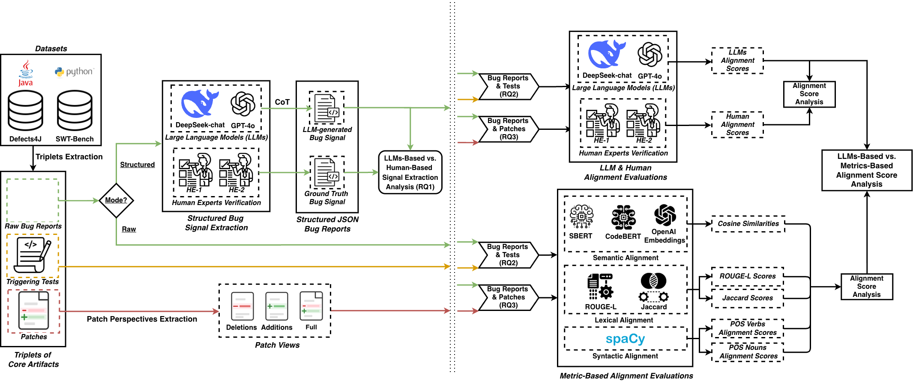

# Desc2Fix

**From Bug Reports to Fixes: A Large-Scale Study of Structural and Semantic Alignment Across Tests and Patches**

Desc2Fix is a reproducible framework for studying how behavioral signals expressed in bug reports propagate to triggering tests and developer-written patches. The package supports structured bug-signal extraction, report-test alignment, report-patch alignment, human evaluation, metric-based analysis, LLM-based judgments, Plotly figures, and an interactive Streamlit dashboard.

<p align="center">
  
</p>

---

## Overview

Bug resolution is a cross-artifact process. A natural-language bug report describes a failure, a triggering test should reproduce the reported behavior, and a patch should correct it. Desc2Fix measures how well these artifacts remain semantically aligned.

The framework combines:

- **Structured bug-signal extraction** from reports.
- **Report-test alignment** analysis.
- **Report-patch alignment** analysis.
- **Metric-based similarity** using lexical, syntactic, and embedding-based proxies.
- **LLM-based semantic judgments** using GPT-4o and DeepSeek-Chat.
- **Human evaluation** for calibration.
- **Plotly HD figures** for papers, slides, and README previews.
- **Streamlit dashboard** for interactive exploration.

---

## Research questions

Desc2Fix currently supports the following research questions:

| RQ | Description | Artifact pair |
|---|---|---|
| RQ1 | Can LLMs reliably extract structured semantic signals from bug reports? | Bug report → structured signals |
| RQ2 | Can report-test alignment serve as an indicator of test adequacy and report testability? | Bug report ↔ test |
| RQ3 | Can report-patch alignment act as a semantic validation signal for program repair? | Bug report ↔ patch |
| RQ4 internal | Can test-patch alignment provide an additional internal consistency signal? | Test ↔ patch |

The paper focuses on RQ1–RQ3. RQ4 is kept as an internal validation track in this replication package.

---

## Structured bug signals

Desc2Fix extracts six structured fields from bug reports:

```text
exception
api_involved
input_conditions
reproduction_steps
expected
actual
```

These fields capture entity-level, scenario-level, and behavioral information. They are used to build structured report representations and support downstream alignment analyses.

---

## Datasets

Desc2Fix currently supports:

| Dataset | Language | Main artifacts |
|---|---|---|
| Defects4J | Java | bug reports, triggering/relevant tests, source/test patches |
| SWT-Bench | Python | GitHub issues, fail-to-pass tests, human-written patches |

The replication package distinguishes between raw reconstructed corpora, processed triplets, structured signal outputs, LLM judge outputs, human annotations, final tables, and generated figures.

---

## Repository layout

```text
Desc2Fix/
├── config/
│   ├── datasets.yaml
│   ├── models.yaml
│   └── paths.yaml
├── dashboard/
│   ├── app.py
│   ├── components.py
│   ├── data_loader.py
│   └── pages/
├── data/
│   ├── cache/
│   ├── processed/
│   ├── raw/
│   └── structured/
├── docs/
│   ├── assets/
│   │   └── DESC2FIX.png
│   ├── DASHBOARD_AND_FIGURES.md
│   ├── HUMAN_EVALUATION.md
│   ├── REPRODUCTION_WORKFLOW.md
│   └── RESULTS_GUIDE.md
├── Human_Eval/
│   ├── RQ1/
│   ├── RQ2/
│   ├── RQ3/
│   └── RQ4/
├── prompts/
├── results/
│   ├── experiments/
│   ├── figures/
│   └── tables/
├── scripts/
└── src/
    └── desc2fix/
```

---

## Installation

### 1. Clone and enter the repository

```bash
git clone <repository-url>
cd Desc2Fix
```

### 2. Create a Python environment

Using `venv`:

```bash
python3.10 -m venv des2fix_env
source des2fix_env/bin/activate
python -m pip install -U pip
```

Using Conda:

```bash
conda env create -f environment.yml
conda activate desc2fix
```

### 3. Install dependencies

```bash
python -m pip install -r requirements.txt
```

For an exact local reproduction, use the lock file if available:

```bash
python -m pip install -r requirements-lock.txt
```

### 4. Install Desc2Fix in editable mode

```bash
python -m pip install -e .
```

If imports fail in a fresh shell, export the source path:

```bash
export PYTHONPATH="$PWD/src:$PYTHONPATH"
```

### 5. Configure API keys

Create a `.env` file at the repository root:

```bash
OPENAI_API_KEY=your_openai_key
DEEPSEEK_API_KEY=your_deepseek_key
```

Model settings are defined in:

```text
config/models.yaml
```

---

## Quick validation

If processed outputs, structured signals, LLM judge outputs, and human annotations are already available, run:

```bash
python scripts/run_rq1_human_extraction_agreement.py \
  --human-root Human_Eval \
  --structured-root data/structured

python scripts/run_human_agreement.py --rq rq2 --human-root Human_Eval
python scripts/run_human_agreement.py --rq rq3 --human-root Human_Eval
python scripts/run_human_agreement.py --rq rq4_internal --human-root Human_Eval

python scripts/generate_human_summary_tables.py --human-root Human_Eval
```

Then check the final summary:

```bash
python - <<'PY'
import pandas as pd

base = "results/tables/human_evaluation"
g = pd.read_csv(f"{base}/global_human_evaluation_summary.csv")
print(g.groupby(["rq", "rq_label"]).size())
PY
```

Expected output:

```text
rq            rq_label               
rq1           RQ1_Extraction              12
rq2           RQ2_Report_Test             96
rq3           RQ3_Report_Patch           288
rq4_internal  RQ4_Test_Patch_Internal    144
dtype: int64
```

---

## End-to-end reproduction workflow

The full workflow is documented in:

```text
docs/REPRODUCTION_WORKFLOW.md
```

High-level steps:

```bash
python scripts/setup_benchmarks.py

python scripts/prepare_corpus.py --dataset defects4j
python scripts/prepare_corpus.py --dataset swtbench

python scripts/extract_signals.py --dataset defects4j --model gpt4o --resume
python scripts/extract_signals.py --dataset defects4j --model deepseek --resume
python scripts/extract_signals.py --dataset swtbench --model gpt4o --resume
python scripts/extract_signals.py --dataset swtbench --model deepseek --resume
```

Run metric and LLM-judge analyses:

```bash
python scripts/run_rq1.py
python scripts/run_rq2.py
python scripts/run_rq3.py
python scripts/run_rq4_internal.py
```

Run LLM judges on the human-evaluation sample:

```bash
python scripts/run_llm_judges.py \
  --rq rq2 \
  --dataset defects4j \
  --model gpt4o \
  --scenario both \
  --sample-from-human Human_Eval \
  --resume
```

For RQ3 and RQ4 internal, use patch views:

```bash
for dataset in defects4j swtbench; do
  for model in gpt4o deepseek; do
    for patch_view in full add remove; do
      python scripts/run_llm_judges.py \
        --rq rq3 \
        --dataset "$dataset" \
        --model "$model" \
        --scenario both \
        --patch-view "$patch_view" \
        --sample-from-human Human_Eval \
        --resume
    done
  done
done
```

---

## Human evaluation

Human annotations are stored in:

```text
Human_Eval/
├── RQ1/
├── RQ2/
├── RQ3/
└── RQ4/
```

The human-evaluation pipeline is documented in:

```text
docs/HUMAN_EVALUATION.md
```

Main commands:

```bash
python scripts/run_rq1_human_extraction_agreement.py \
  --human-root Human_Eval \
  --structured-root data/structured

python scripts/run_human_agreement.py --rq rq2 --human-root Human_Eval
python scripts/run_human_agreement.py --rq rq3 --human-root Human_Eval
python scripts/run_human_agreement.py --rq rq4_internal --human-root Human_Eval
```

Final tables:

```bash
python scripts/generate_human_summary_tables.py --human-root Human_Eval
```

Output:

```text
results/tables/human_evaluation/
```

---

## Results

The main consolidated table is:

```text
results/tables/human_evaluation/global_human_evaluation_summary.csv
```

Detailed result interpretation is documented in:

```text
docs/RESULTS_GUIDE.md
```

Important files:

```text
results/tables/human_evaluation/rq1_llm_vs_human_summary.csv
results/tables/human_evaluation/RQ2_Report_Test_human_llm_agreement.csv
results/tables/human_evaluation/RQ3_Report_Patch_human_llm_agreement.csv
results/tables/human_evaluation/RQ4_Test_Patch_Internal_human_llm_agreement.csv
```

---

## Figures

Desc2Fix uses Plotly for all final visualizations.

Generate figures:

```bash
python scripts/generate_plotly_figures.py
```

Output:

```text
results/figures/human_evaluation_plotly/
```

Each figure is exported as:

```text
.html
.png
.pdf
```

The PDF files are suitable for LaTeX. The PNG files are suitable for README pages and slides. The HTML files are interactive.

Figure and dashboard documentation:

```text
docs/DASHBOARD_AND_FIGURES.md
```

---

## Dashboard

The Streamlit dashboard is located in:

```text
dashboard/
```

Run:

```bash
streamlit run dashboard/app.py
```

Dashboard pages:

```text
Overview
Corpus
RQ1 Extraction
RQ2 Report-Test
RQ3 Report-Patch
RQ4 Internal Test-Patch
Artifact Browser
```

The dashboard reads:

```text
results/tables/human_evaluation/
results/figures/human_evaluation_plotly/
```

---

## Documentation

| File | Purpose |
|---|---|
| `docs/HUMAN_EVALUATION.md` | Human annotations, RQ mapping, agreement scripts, debug files |
| `docs/REPRODUCTION_WORKFLOW.md` | End-to-end reproduction workflow |
| `docs/RESULTS_GUIDE.md` | How to read and interpret result tables |
| `docs/DASHBOARD_AND_FIGURES.md` | Plotly figures and Streamlit dashboard |
| `dashboard/README.md` | Dashboard-specific usage |

---

## Key outputs

```text
results/experiments/rq1_human_extraction/
results/experiments/human_agreement/
results/experiments/llm_judges/
results/tables/human_evaluation/
results/figures/human_evaluation_plotly/
```

---

## Troubleshooting

### Missing package

```bash
python -m pip install -r requirements.txt
```

### Missing static image export

```bash
python -m pip install -U kaleido
```

### Dashboard not found

Run from repository root:

```bash
streamlit run dashboard/app.py
```

### Missing final tables

```bash
python scripts/generate_human_summary_tables.py --human-root Human_Eval
```

### Missing figures

```bash
python scripts/generate_plotly_figures.py
```

---

## Citation

If you use Desc2Fix, please cite:

```bibtex

```

---

## License


---

## Contact

For questions, please open an issue or contact the maintainers.
